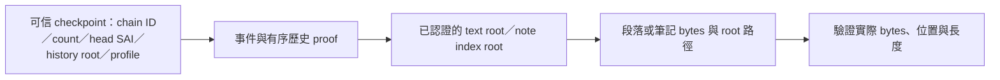

# 局部驗證與完整版本承諾

2026-10-12 提案，未實作。上游規格：[VAX incremental verification](https://github.com/bnggbn/vax-action-history/blob/fix/jcs-utf8-order/docs/INCREMENTAL_VERIFICATION.md)。

局部驗證可以確認取回的事件、段落或筆記確實屬於可信的完整版本；不能在未讀取其他檔案的情況下確認那些實體 bytes 此刻無損／仍可取得。完整性承諾、應用規則、實體資料稽核須分開回報。

## 行為鏈

首次建立 checkpoint 必須完整驗證既有鏈、應用規則及內容，或採已信任驗證者的認證 checkpoint。之後新增版本從已驗證前綴接續，驗完每個新增事件再發布新 head；歷史 consistency proof 保證舊前綴未改，不取代事件語意驗證。

使用平衡 Merkle 歷史索引時，單事件 membership proof 是對數規模；讀段落只取所需完整葉與路徑。實際成本還包括該葉 bytes、事件驗證與索引 I/O，不能宣稱所有保存或首次驗證都只要 O(log n)。正文筆記樹和歷史索引各自有 root／型別／編碼與深度限制。

## 現有格式的界線

- 正式 SAE 目前承諾全文 SHA-256 與 canonical notes hash，沒有 textRoot／notesRoot。不能由 chunk hashes 合成原全文 SHA-256；單看 manifest／catalog 供應的 root，也不能證明它對應原事件。
- 舊鏈可於完整驗證後建立受保護 checkpoint，認證事件原 hash 與實際物件 root 的對照；保留原 envelope／SAI bytes。缺可信對照就回到現有完整驗證。
- 新 schema 可將 root 寫進 SAE；若仍保留全文 hash，建立事件時仍須算全文，只能改善後續局部讀取。root-only 事件是另一項顯式遷移，不能偷偷切換。
- 現有筆記是整包 blob，單條筆記局部驗證需要逐條物件＋有序索引樹。proof 本身不會解掉 O(N²) 儲存。
- VAX L0 的 SAI 公式不用改；可重用的有界 proof primitives 放上游附屬模組，storage 提供選擇性路徑與 bytes 驗證，Pageforge 處理文件／還原關係、信任與發布 CAS。

## 信任與稽核

與書庫一起可被替換的 unsigned checkpoint 不能當信任根。記憶體收據在重啟後要重新建立基準；持久收據須有受保護的認證來源及已接受 head／count，否則舊合法 checkpoint 仍能被回滾重放。多人交換需要已知的驗證者／owner 公鑰或獨立取得的可信錨點；簽章證明簽署者，不單獨證明簽署者做過全文稽核。

API 未來需回報 checkpoint、已驗範圍及上次完整稽核；partial 狀態不能等同整庫 bytes 本次全驗。背景／手動完整稽核掃描全部可達內容，會在讀到未使用的損壞物件時報錯。稽核也只能回報檢查時的結果，外部跨檔案寫入仍需要獨立的快照／鎖策略。

建議先做可視區閱讀與逐條筆記物件，再接續驗證收據和選擇性讀取，最後補有序歷史 proof 與持久信任錨點。完整稽核模式保留；本輪不撤掉 history／record／object 數量及復原預算。

## 驗收要求

錯 chain／profile／count／index、改寫 bytes／SAI／root 對照、調換葉次序、少／多 proof 節點、歷史截斷、還原引用、checkpoint 回滾及 proof 容量都須有否定案例。改壞未讀葉不能讓局部結果假稱整庫已驗，而要在讀取該葉或完整稽核時查出。proof 接受結果須與現有完整 verifier 對照。
